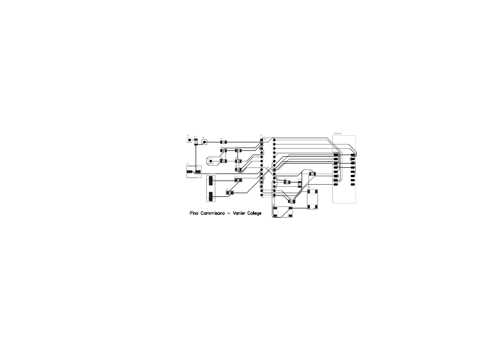

# PCB Probe Project

A custom printed circuit board designed for a test/measurement probe, taken through three design revisions to a final, fabrication-ready layout — from schematic capture through to Gerbers.

## Overview

This repo holds both the design source and the manufacturing outputs for the "Probe" PCB, from the Altium project `PCB_Project_Probe.PrjPcb`. The board went through three iterations (`PCB1`, `PCB2`, `PCB3-FINAL`), each checked with a Design Rule Check (DRC) before the final revision was released for fabrication.

## Contents

`altium-source/` holds the original design files:
- `probe-schematic.SchDoc` — the Altium schematic for the probe circuit
- `probe-pcb-3d-model.step` — a 3D STEP export of the final board, viewable in any CAD tool or online STEP viewer

`gerber/` contains the full fabrication package for the final board (`PCB3-FINAL`):

- **Gerber layers** (`.GTL`, `.GBL`, `.GTO`, `.GBO`, `.GTP`, `.GBP`, `.GTS`, `.GBS`, `.GKO`, `.GM*`) — copper, silkscreen, paste, soldermask, and mechanical/outline layers for both sides of the board
- **NC drill files** (`.TXT`, `.DRR`, `.LDP`) — hole locations and tool sizes for the drilling machine
- **Reports** (`.REP`, `.EXTREP`) — drill and board reports summarizing hole counts, tool sizes, and layer stack
- **Design Rule Check results** — `Design Rule Check - PCB1.html/.drc`, `PCB2.html/.drc`, and `PCB3-FINAL.html/.drc`, documenting the clearance/routing checks run at each revision
- `Status Report.Txt` — the CAM output log from the final Gerber/drill generation run

`images/probe-schematic-render.pdf` — a clean rendered view of the schematic/routing, titled and signed as the final deliverable.

## Notes

The Gerber/NC drill files are manufacturing outputs, not editable board source — but the Altium schematic and STEP model in `altium-source/` are the real design files, so the board can be traced, reviewed, or modified from here rather than just re-fabricated as-is. The three DRC reports let you trace how the design was cleaned up across revisions before the final board (`PCB3-FINAL`) was signed off for fabrication.
